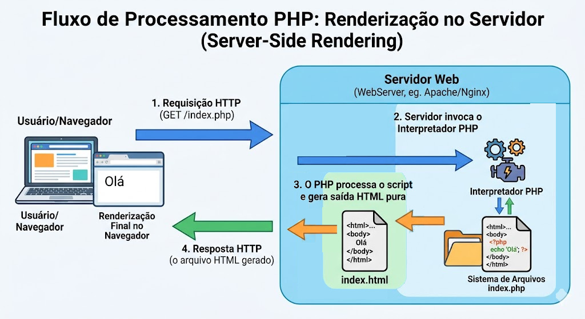

# PHP

[Slides desta aula (PDF)](slides/aula_11_php.pdf), que cobrem também o material de [Programação Back-end](aula_10_back_end.md).

## Bibliografia recomendada para o tema

* [Documentação oficial do PHP (pt-BR)](https://www.php.net/manual/pt_BR/);
* [PHP The Right Way (boas práticas)](https://phptherightway.com/);
* [W3Schools - PHP Tutorial](https://www.w3schools.com/php/default.asp);
* NIEDERAUER, Juliano. **Desenvolvendo Websites com PHP**. São Paulo: Novatec, 2011 (bibliografia complementar da disciplina).

> Até aqui, todo o código da disciplina rodou no navegador. Na aula de Fetch
> API e JSON, o catálogo passou a ser montado pelo JavaScript, a partir do
> `produtos.json` pedido ao servidor. Nesta aula, o código passa a rodar no
> servidor: o PHP monta o HTML do catálogo antes de enviá-lo, primeiro a partir
> de um array escrito no próprio código, depois a partir do mesmo
> `produtos.json`. Na Entrega 3 do trabalho prático, os produtos virão do banco
> de dados.

## Objetivos da aula

Ao final desta aula você deve ser capaz de:

1. Explicar o que o interpretador do PHP faz com um arquivo `.php`, e o que chega
   ao navegador;
2. Iniciar o servidor embutido do PHP e abrir uma página `.php` por ele;
3. Declarar variáveis, reconhecer os tipos básicos e usar os operadores de
   comparação `==` e `===`;
4. Montar textos com concatenação, interpolação e funções de string;
5. Criar arrays indexados e associativos, e percorrê-los com `foreach`;
6. Usar `if`, `elseif` e `else` para decidir que HTML é produzido;
7. Ler um arquivo JSON com `json_decode` e montar o catálogo a partir dele.

---

## Material de exemplo

Os exercícios desta aula não têm repositório nem entrega. Faça-os em uma pasta
nova, `aula-php/`, fora do repositório do trabalho prático. A seção 12 cria a
pasta e o primeiro arquivo.

# Parte teórica

## 1. Uma página gerada no servidor

Crie o arquivo `ola.php`:

```php
<!DOCTYPE html>
<html lang="pt-BR">
<head>
  <meta charset="UTF-8">
  <title>Olá, PHP</title>
</head>
<body>
  <h1>Olá, PHP</h1>
  <p>Número sorteado no servidor: <?= rand(1, 6) ?></p>
</body>
</html>
```

Na pasta do arquivo, inicie o servidor embutido do PHP e abra
`http://localhost:8000/ola.php`:

```bash
php -d display_errors=1 -S localhost:8000
```

Recarregue a página algumas vezes: o número muda. Abra o código-fonte da página
(`Ctrl+U`): no lugar de `<?= rand(1, 6) ?>` aparece só o número. O navegador
recebeu um HTML comum, sem nenhuma linha de PHP.

O servidor recebeu a requisição, viu que o arquivo pedido termina em `.php` e o
passou ao interpretador do PHP. O interpretador executou o trecho entre `<?=` e
`?>`, trocou-o pelo resultado e devolveu o HTML pronto, que o servidor enviou na
resposta HTTP. A cada requisição, o processo se repete, e o sorteio também.



O material de [Programação Back-end](aula_10_back_end.md) descreve o papel do
servidor web e do interpretador, e a instalação do PHP em casa.

## 2. O servidor embutido do PHP

O comando da seção 1, executado dentro de uma pasta, serve os arquivos dessa
pasta em `http://localhost:8000`. Os arquivos `.php` passam pelo interpretador;
os demais (HTML, CSS, imagens, JSON) são entregues como estão. `Ctrl+C` encerra
o servidor.

A opção `-d display_errors=1` faz o PHP escrever as mensagens de erro na própria
página. Sem ela, conforme a configuração instalada, a página com erro pode
chegar em branco. O terminal onde o servidor está rodando mostra uma linha por
requisição, com o status e, quando houver, a mensagem de erro:

```text
[Mon Oct 26 12:35:47 2026] [::1]:33222 [200]: GET /ola.php
```

A extensão Live Server e o `python3 -m http.server`, usados no material de
Fetch API e JSON, entregam o arquivo `.php` sem executá-lo: o navegador mostra o
código ou oferece o arquivo para *download*. O mesmo acontece ao abrir o arquivo
com dois cliques, pelo endereço `file://`.

## 3. Tags PHP

O interpretador procura as tags de abertura e fechamento, `<?php` e `?>`, que
delimitam onde o código PHP começa e termina. Tudo o que estiver fora delas vai
para a saída como texto (em geral HTML), sem alteração. Isso permite embutir
código PHP em documentos HTML.

Duas formas de abertura são usadas no PHP atual:

1. **Tag padrão:** `<?php ... ?>`, para blocos de código;
2. **Tag curta de impressão:** `<?= ... ?>`, que imprime um valor no HTML. É
   equivalente a `<?php echo ... ?>`.

O PHP já teve outras formas de abertura, como `<%` (estilo ASP) e `<?`. A
primeira foi removida da linguagem, e a segunda é desencorajada, por depender de
configuração do servidor e conflitar com a sintaxe do XML.

### 3.1. PHP e HTML no mesmo arquivo

```php
<p>Isto vai ser ignorado pelo PHP e enviado diretamente ao navegador.</p>
<?php echo 'Enquanto isto vai ser processado no servidor.'; ?>
<p>Isto também vai ser ignorado pelo interpretador.</p>
```

O navegador recebe:

```html
<p>Isto vai ser ignorado pelo PHP e enviado diretamente ao navegador.</p>
Enquanto isto vai ser processado no servidor.<p>Isto também vai ser ignorado pelo interpretador.</p>
```

A quebra de linha logo depois de um `?>` é engolida pelo interpretador, por isso
as duas últimas linhas ficaram juntas. No navegador, a diferença não aparece.

### 3.2. Ponto e vírgula e a tag de fechamento

Cada instrução PHP termina com ponto e vírgula (`;`). A tag `?>` encerra também
a instrução anterior, por isso o `;` da última linha antes dela é opcional.

Se um arquivo contém **apenas** código PHP, sem HTML (um arquivo de funções ou
de configuração, por exemplo), a tag de fechamento `?>` deve ser omitida. Um
espaço ou uma quebra de linha depois dela iria para a saída, e isso causa o erro
*headers already sent* quando o arquivo é incluído antes de um envio de
cabeçalho HTTP, assunto das aulas de formulários e de sessões.

```php
<?php
// Arquivo com apenas código PHP: termina sem a tag de fechamento.

echo 'Isto é um teste';
$variavel = 10;
```

O comentário do exemplo não cita a tag de fechamento de propósito. Um `?>`
dentro de um comentário de linha (`//` ou `#`) encerra o modo PHP do mesmo
jeito, e o que vem depois dele vai para a saída como texto.

## 4. Variáveis e tipos

Toda variável começa com `$`, e o nome diferencia maiúsculas de minúsculas
(`$preco` e `$Preco` são duas variáveis). Não há `let` nem `const`: a variável
passa a existir na primeira atribuição.

```php
<?php
$nome = "Café em grão";   // string
$estoque = 12;            // int
$preco = 32.5;            // float
$disponivel = true;       // bool
$cupom = null;            // null
```

O tipo vem do valor, como no JavaScript. Para ver o tipo e o valor de uma
variável durante o desenvolvimento, use `var_dump`:

```php
var_dump($preco);   // float(32.5)
var_dump($nome);    // string(14) "Café em grão"
```

O `14` é o tamanho da string em bytes. `é` e `ã` ocupam dois bytes cada em
UTF-8, por isso o valor é maior que os 12 caracteres do texto (a seção 11 trata
disso).

Os operadores aritméticos são os do JavaScript: `+`, `-`, `*`, `/` e `%`. Os de
comparação também, incluindo a diferença entre `==` e `===`:

```php
var_dump(1 == "1");    // bool(true): compara o valor, convertendo o tipo
var_dump(1 === "1");   // bool(false): compara valor e tipo
```

Como no JavaScript, prefira `===` e `!==`, que não convertem o tipo.

## 5. Strings

### 5.1. Concatenação com ponto

No PHP, o operador de concatenação é o ponto (`.`), e não o `+`. O `+` é sempre
soma:

```php
var_dump("1" + "1");   // int(2)
var_dump("1" . "1");   // string(2) "11"
```

Com uma string que não representa número, o `+` interrompe o script com erro.
`"Preço: " + $preco` produz:

```text
Fatal error: Uncaught TypeError: Unsupported operand types: string + float
```

O operador `.=` acrescenta texto ao fim de uma variável:

```php
$html = "<ul>";
$html .= "<li>Café em grão</li>";
$html .= "</ul>";
```

### 5.2. Aspas simples e aspas duplas

Entre aspas duplas, o PHP substitui as variáveis pelo valor delas
(**interpolação**), como a *template string* do JavaScript. Entre aspas
simples, o texto fica como está:

```php
$nome = "Café em grão";
echo "Produto: $nome";      // Produto: Café em grão
echo 'Produto: $nome';      // Produto: $nome
echo "Produto: {$nome}!";   // Produto: Café em grão!
```

As chaves delimitam a variável dentro do texto. Use-as sempre que a variável
for seguida de letra ou for um elemento de array (seção 6).

### 5.3. Funções de string

| Função | Exemplo | Resultado |
|---|---|---|
| `strlen` | `strlen("Chá")` | `4` (bytes, ver seção 11) |
| `strtoupper` | `strtoupper("Bebidas")` | `"BEBIDAS"` |
| `strtolower` | `strtolower("Bebidas")` | `"bebidas"` |
| `trim` | `trim("  Café  ")` | `"Café"` |
| `str_contains` | `str_contains("Café em grão", "grão")` | `true` |
| `str_replace` | `str_replace(".", ",", "32.5")` | `"32,5"` |
| `number_format` | `number_format(1234.5, 2, ",", ".")` | `"1.234,50"` |

`number_format` recebe o número, a quantidade de casas decimais, o separador
decimal e o separador de milhar, e arredonda: `number_format(27.625, 2, ",", ".")`
dá `"27,63"`. É uma forma de mostrar preço no formato brasileiro.

`strtoupper` e `strtolower` só convertem letras sem acento:
`strtoupper("Café")` dá `"CAFé"`. A seção 11 indica as funções que tratam
acentos.

A lista completa está na
[referência de funções de string](https://www.php.net/manual/pt_BR/ref.strings.php).

## 6. Arrays

### 6.1. Arrays indexados

Um array indexado guarda valores em sequência, a partir do índice `0`:

```php
$categorias = ["Bebidas", "Doces", "Grãos"];
echo $categorias[0];        // Bebidas
echo count($categorias);    // 3

$categorias[] = "Temperos"; // acrescenta ao fim, como o push do JavaScript
echo count($categorias);    // 4
```

### 6.2. Arrays associativos

Num array associativo, cada valor tem uma **chave** de texto no lugar do
índice. A seta `=>` liga a chave ao valor:

```php
$produto = [
  "id" => 1,
  "nome" => "Café em grão",
  "categoria" => "Bebidas",
  "preco" => 32.5,
  "desconto" => 0.15,
];

echo $produto["nome"];                // Café em grão
echo "Preço: {$produto["preco"]}";    // Preço: 32.5
```

É o papel que o objeto cumpre no JavaScript, mas o acesso é sempre com
colchetes e a chave entre aspas: `$produto["nome"]`, e não `produto.nome`.

### 6.3. Array de arrays

O catálogo é um array indexado em que cada elemento é um array associativo, a
mesma forma do array de objetos do `produtos.js` e do `produtos.json`:

```php
$produtos = [
  ["nome" => "Café em grão", "preco" => 32.5],
  ["nome" => "Chá mate", "preco" => 12.9],
];

echo $produtos[1]["nome"];   // Chá mate
```

Para inspecionar um array durante o desenvolvimento, `print_r` mostra as chaves
e os valores, e `var_dump` mostra também os tipos. `print_r($produtos[0])`
mostra:

```text
Array
(
    [nome] => Café em grão
    [preco] => 32.5
)
```

`echo` com um array imprime só a palavra `Array`, com o aviso
`Warning: Array to string conversion`.

## 7. Estruturas de controle

### 7.1. `if`, `elseif` e `else`

```php
if ($produto["desconto"] > 0.2) {
  echo "Promoção";
} elseif ($produto["desconto"] > 0) {
  echo "Com desconto";
} else {
  echo "Preço normal";
}
```

`elseif` é uma palavra só. Os operadores lógicos são `&&`, `||` e `!`, como no
JavaScript.

### 7.2. `foreach`

`foreach` percorre um array, um elemento por vez. É o laço usado para montar
listas de HTML:

```php
foreach ($produtos as $produto) {
  echo "<li>{$produto["nome"]}</li>";
}
```

Para ter também o índice ou a chave, use `as $chave => $valor`:

```php
foreach ($produto as $chave => $valor) {
  echo "$chave: $valor\n";
}
```

### 7.3. `for` e `while`

Têm a mesma forma do JavaScript, com `$` nas variáveis:

```php
for ($i = 1; $i <= 3; $i++) {
  echo "<p>Parcela $i</p>";
}

$estoque = 3;
while ($estoque > 0) {
  echo "<p>Restam $estoque</p>";
  $estoque--;
}
```

### 7.4. Sintaxe alternativa dentro do HTML

Quando a estrutura de controle envolve blocos de HTML, o PHP aceita uma sintaxe
alternativa, com dois pontos (`:`) no lugar da chave de abertura e uma palavra
de fechamento (`endif;`, `endforeach;`, `endfor;`, `endwhile;`) no lugar da
chave de fechamento. Ela torna mais fácil ver onde cada bloco termina no meio do
HTML:

```php
<ul>
  <?php foreach ($produtos as $produto): ?>
    <li>
      <?= $produto["nome"] ?>
      <?php if ($produto["preco"] < 20): ?>
        <strong>até R$ 20</strong>
      <?php endif; ?>
    </li>
  <?php endforeach; ?>
</ul>
```

O interpretador repete o `<li>` uma vez por produto e só envia o `<strong>`
quando a condição é verdadeira. Escrever o HTML fora das tags, como acima,
costuma ser mais legível do que montá-lo dentro de strings com `echo`.

## 8. Funções

```php
function formataPreco(float $valor): string {
  return "R$ " . number_format($valor, 2, ",", ".");
}

echo formataPreco(27.625);   // R$ 27,63
```

Os tipos dos parâmetros (`float $valor`) e do retorno (`: string`) são
opcionais, mas documentam a função e fazem o PHP interromper o script com erro
quando ela recebe um valor que não pode ser convertido, como a string `"abc"`. As variáveis de fora da função não são visíveis dentro
dela: o que a função usa entra pelos parâmetros.

## 9. JSON no PHP

O mesmo `produtos.json` lido pelo `fetch` pode ser lido pelo PHP, em duas
etapas:

```php
$conteudo = file_get_contents("produtos.json");   // o texto do arquivo
$produtos = json_decode($conteudo, true);          // o texto convertido em array
```

O `true` do `json_decode` pede arrays associativos para os objetos do JSON. O
resultado tem a forma do array de arrays da seção 6.3, e o mesmo `foreach`
serve para os dois.

O caminho inverso é `json_encode`, que converte um array em texto JSON. É com
ele que um back-end em PHP responde a um `fetch` no modelo de API descrito no
material de [Programação Back-end](aula_10_back_end.md).

Se o arquivo tiver erro de sintaxe, `json_decode` devolve `null`, sem mensagem.
`json_last_error_msg()` diz qual foi o erro, por exemplo `Syntax error`.

## 10. Quando dá errado

| Sintoma | Causa provável |
|---|---|
| a página mostra o código PHP, ou o navegador baixa o arquivo | página aberta sem o servidor do PHP (seção 2) |
| página em branco | erro com `display_errors` desligado; a mensagem está no terminal do servidor |
| `Parse error: syntax error, unexpected token "echo"` | `;` faltando na linha anterior à indicada |
| `Warning: Undefined variable $preço` | nome digitado diferente da atribuição, ou variável de fora usada dentro de função |
| `Warning: Undefined array key "desconto"` | o elemento não tem essa chave; confira o nome e o JSON |
| `Unsupported operand types: string + float` | `+` usado para concatenar; use `.` |
| a palavra `Array` na página, com `Array to string conversion` | `echo` aplicado a um array inteiro |
| `$nome` aparece literalmente na página | variável entre aspas simples |
| `foreach() argument must be of type array\|object, null given` | `json_decode` devolveu `null`: erro de sintaxe no JSON ou caminho errado |

## 11. Para ler depois

Esta seção é leitura complementar e não é tratada na aula.

* **Strings com acento.** As funções da seção 5.3 trabalham com bytes. As
  funções da extensão *mbstring* trabalham com caracteres: `mb_strlen("Chá")` dá
  `3`, e `mb_strtoupper("Café")` dá `"CAFÉ"`. A extensão nem sempre vem
  instalada; no Fedora, por exemplo, o pacote é `php-mbstring`.
* **`printf` e `sprintf`**, que montam texto a partir de um molde:
  `sprintf("%s custa %.2f", $nome, $preco)`.
* **Funções de array** como `array_filter`, `array_map` e `usort`,
  equivalentes ao `filter`, `map` e `sort` do JavaScript. Veja a
  [referência de arrays](https://www.php.net/manual/pt_BR/ref.array.php).
* **`htmlspecialchars`**, que impede que um texto vindo de fora seja
  interpretado como HTML. É assunto da aula de formulários.

# Parte prática

Os exercícios desta parte não têm entrega e não valem nota. Cada um acrescenta
uma etapa ao anterior, na pasta `aula-php/`.

## 12. O ambiente

Abra um terminal e confira que o PHP está instalado:

```bash
php -v
```

Crie a pasta `aula-php/`, fora do repositório do trabalho, e dentro dela o
`ola.php` da seção 1. Inicie o servidor dentro da pasta:

```bash
php -d display_errors=1 -S localhost:8000
```

Abra `http://localhost:8000/ola.php`, recarregue algumas vezes e confira que o
número muda. Abra o código-fonte da página com `Ctrl+U` e confira que não há PHP
nele. No terminal do servidor, confira uma linha `[200]: GET /ola.php` por
recarga.

## 13. O preço com desconto

Crie o `preco.php` com as variáveis de um produto e um parágrafo que mostra o
preço com desconto:

```php
<?php
$nome = "Café em grão";
$categoria = "Bebidas";
$preco = 32.5;
$desconto = 0.15;
?>
<!DOCTYPE html>
<html lang="pt-BR">
<head>
  <meta charset="UTF-8">
  <title>Preço</title>
</head>
<body>
  <!-- complete aqui -->
</body>
</html>
```

No `<body>`, escreva:

1. um `<h1>` com o nome e, entre parênteses, a categoria em maiúsculas, com
   `strtoupper`;
2. um `<p>` com o preço original e o preço com desconto, os dois com
   `number_format`.

Calcule o preço com desconto numa variável `$precoFinal`, no bloco PHP do topo.
Confira na página:

```text
Café em grão (BEBIDAS)
De R$ 32,50 por R$ 27,63
```

Troque o `.` de uma concatenação por `+`, recarregue e leia a mensagem de erro.
Desfaça a troca.

## 14. O catálogo com `foreach`

Crie o `catalogo.php` com um array de três produtos no topo:

```php
<?php
$produtos = [
  [
    "id" => 1,
    "nome" => "Café em grão",
    "descricao" => "Grãos de torra média, de produção familiar.",
    "categoria" => "Bebidas",
    "preco" => 32.5,
    "desconto" => 0.15,
  ],
  [
    "id" => 2,
    "nome" => "Chá mate",
    "descricao" => "Folhas de erva-mate tostadas.",
    "categoria" => "Bebidas",
    "preco" => 12.9,
    "desconto" => 0,
  ],
  [
    "id" => 3,
    "nome" => "Pão de mel",
    "descricao" => "Coberto com chocolate meio amargo.",
    "categoria" => "Doces",
    "preco" => 8,
    "desconto" => 0.1,
  ],
];
?>
```

Abaixo do bloco, escreva a página com:

1. um `<p>` com a quantidade de produtos, com `count`;
2. um `<article class="cartao">` por produto, com `foreach` na sintaxe
   alternativa da seção 7.4, e dentro dele um `<h2>` com o nome, um `<p>` com a
   descrição e um `<p>` com o preço formatado.

Confira os três cartões na página e, no `Ctrl+U`, três `<article>` no HTML
recebido. Acrescente um quarto produto ao array e confira que ele aparece sem
nenhuma outra alteração.

## 15. O desconto com `if`

No `catalogo.php`, escreva no bloco do topo a função `formataPreco` da seção 8,
e use-a em todos os preços.

Dentro de cada cartão, troque o parágrafo do preço por um `if` na sintaxe
alternativa: se o desconto for maior que zero, mostre o preço original dentro de
`<s>` e, ao lado, o preço com desconto; senão, mostre só o preço. Confira:

```text
Café em grão     R$ 32,50 R$ 27,63
Chá mate         R$ 12,90
Pão de mel       R$ 8,00 R$ 7,20
```

## 16. O catálogo pelo `produtos.json`

Copie para a pasta `aula-php/` o `produtos.json` da Entrega 2 do trabalho, ou
crie um com os três produtos do exercício anterior escritos em JSON. Abra
`http://localhost:8000/produtos.json` e confira que o servidor entrega o arquivo.

No `catalogo.php`, troque o array escrito no código pela leitura do arquivo,
conforme a seção 9. Recarregue e confira que os cartões são os do arquivo.
Acrescente um produto ao `produtos.json` e confira que ele aparece sem nenhuma
alteração no PHP.

Se aparecer `Undefined array key`, algum produto do arquivo não tem uma das
chaves usadas no cartão. Acrescente a chave ao produto (por exemplo,
`"desconto": 0`) ou ajuste o nome usado no PHP.

## 17. Filtro por categoria

No topo do `catalogo.php`, crie a variável `$categoria = "Bebidas";`. Dentro do
`foreach`, use um `if` para mostrar apenas os produtos dessa categoria.

O `<p>` da quantidade vem antes dos cartões, então a contagem precisa estar
pronta antes do HTML. No bloco do topo, crie `$mostrados = 0;` e, num `foreach`
com um `if`, some 1 a ela para cada produto da categoria. Use `$mostrados` no
`<p>`. Troque o valor de `$categoria`, recarregue e confira os cartões e a
quantidade.

Na aula de formulários, o valor de `$categoria` deixa de estar no código e passa
a vir do endereço da página, como em `catalogo.php?categoria=Bebidas`.

## Resumo

* O servidor passa os arquivos `.php` ao interpretador, que executa o que está
  entre as tags e devolve HTML. O navegador nunca recebe o código PHP.
* Nas aulas, o servidor é o embutido do PHP:
  `php -d display_errors=1 -S localhost:8000`, dentro da pasta dos arquivos.
* Variáveis começam com `$`. A concatenação é com `.`; o `+` é sempre soma.
* Aspas duplas interpolam variáveis; aspas simples não.
* Arrays associativos usam `"chave" => valor`, e o acesso é com
  `$produto["chave"]`.
* `foreach` e `if`, na sintaxe alternativa, decidem que HTML é enviado.
* `json_decode($texto, true)` converte JSON em array associativo.
